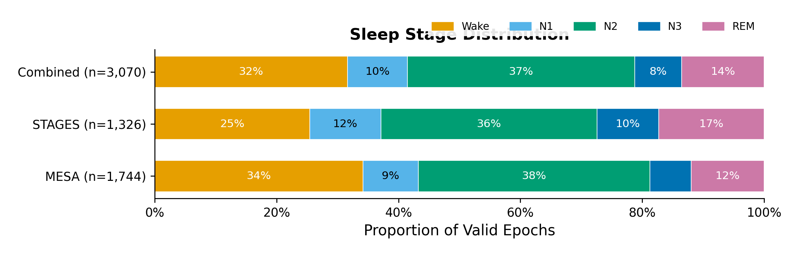
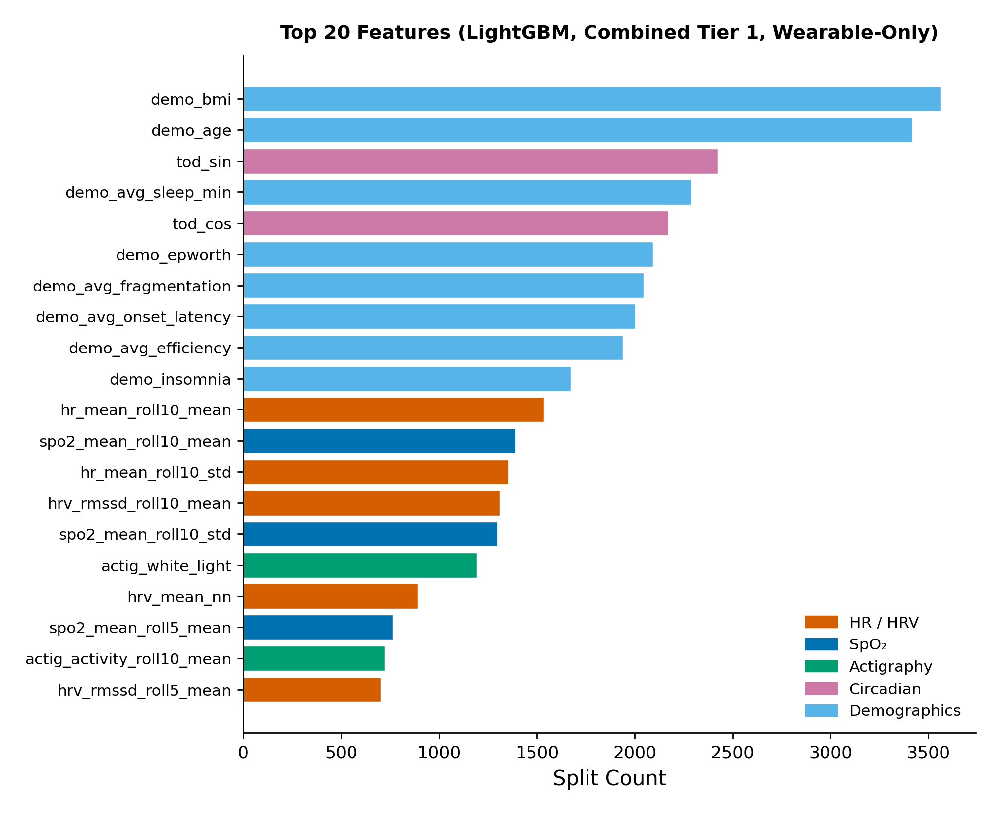
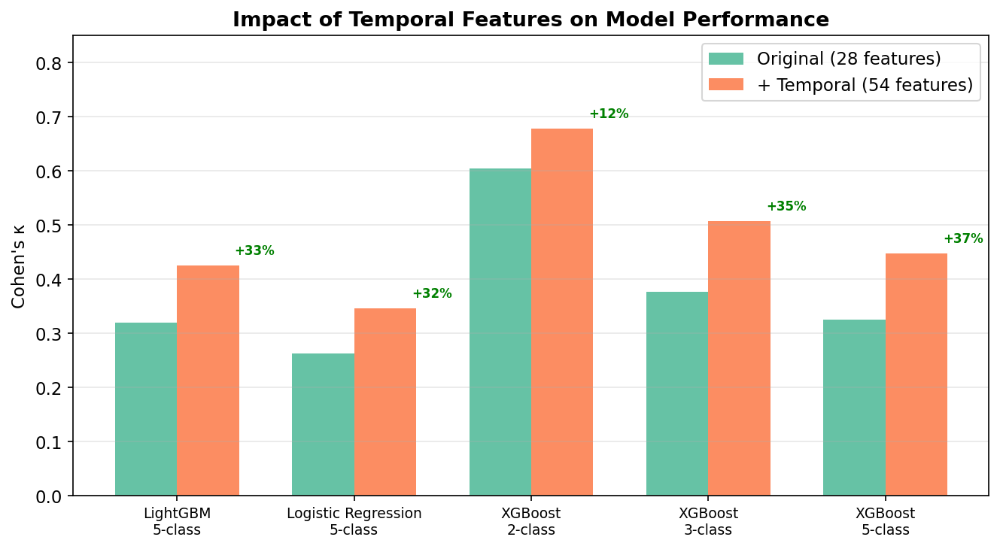
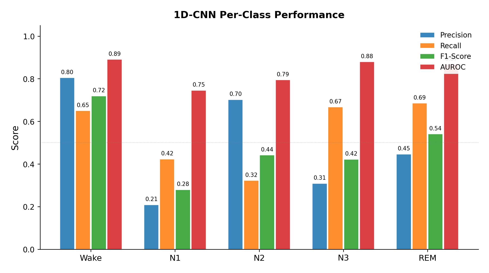
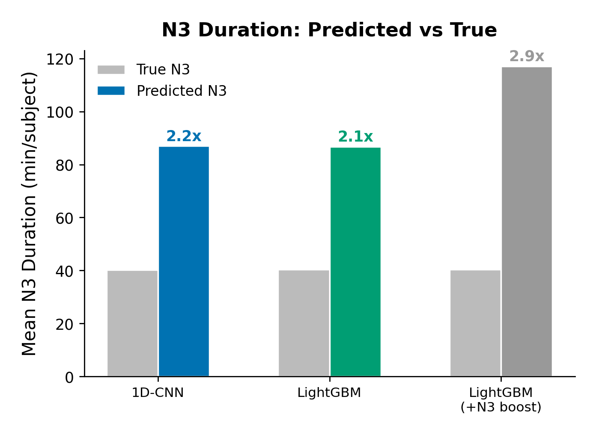

# Wearable Sleep Stage Classification — Research Notes

**Last updated:** 2026-05-18
**Scope:** consumer-wearable-collectible features → PSG-scored sleep stages
**Datasets:** MESA + STAGES (NSRR) for training/cross-site; DREAMT (PhysioNet Empatica E4) as held-out cross-sensor test domain
**Headline numbers:**

| Setting | Best κ | Best model |
|---|---:|---|
| In-domain, MESA-only, 5-class | **0.484** | 1D-CNN (full feature set incl. PSG-only) |
| In-domain, MESA-only, 5-class — wearable features only | **0.462** | XGBoost (71 feat incl. demographics) |
| Cross-site MESA → STAGES (A) | **0.295** | LightGBM + z-score + HMM |
| Cross-site STAGES → MESA (B) | **0.263** | LightGBM + z-score + HMM — *stuck* |
| Combined → MESA (C) | **0.536** | Bi-LSTM (sl=120) + HMM |
| Combined → STAGES (D) | **0.320** | LightGBM + z-score + HMM |
| Zero-shot DREAMT (Empatica wrist PPG) | **0.146** | Bi-LSTM (sl=120) + HMM |
| DREAMT after 50-subject calibration fine-tune | **0.238** | Bi-LSTM fine-tuned |

**Status:** methodology phase complete. Hard ceiling identified at κ ≈ 0.30–0.45 for cross-domain wearable PSG-equivalent staging given the current feature pipeline.

These notes are written for a researcher reproducing or extending the work — they keep the failures alongside the wins so dead ends aren't relearned.

---

## 1. The question

Can consumer-wearable features alone — HR, HRV, SpO2, actigraphy, circadian time — predict PSG-scored sleep stages well enough to be clinically useful, **and how well does that transfer across sites and sensors?**

Published wearable-only work (Walch et al. 2019 with Apple Watch) reports κ in 0.35–0.52. The unanswered questions this project addresses:

1. What's the in-domain ceiling on a large general-population dataset (MESA, 1,744 subjects)?
2. How much κ is lost crossing between two clinical NSRR datasets (MESA ↔ STAGES)?
3. How much further is lost crossing to a *different sensor entirely* (wrist PPG vs clinical EKG, DREAMT)?
4. Which adaptation strategies actually help?

---

## 2. Datasets

| Dataset | Population | Subjects | Valid Epochs | Valid Rate | Notes |
|---|---|---:|---:|---:|---|
| MESA | Community-dwelling adults, 54–93 yr | 1,744 | 1,893,179 | 85.3% | Standard NSRR layout, XML scoring, pre-computed HR |
| STAGES | Clinical sleep lab, 13 sites | 1,326 | 765,360 | 57.3% | Non-standard paths, CSV scoring, JSON actigraphy; HR derived from raw EKG |
| DREAMT | OSA-clinical (mean AHI ≈ 30), Empatica E4 wrist PPG | 100 | ~80K | 75.6% | Held-out test domain, no SpO2 sensor |

NSRR datasets differ significantly in file layout and scoring format — each dataset has its own build script. See [CLAUDE.md](../CLAUDE.md) for the heterogeneity matrix.

**Site quality within STAGES**: Tier 1 sites (Stanford, MedSleep TR) provide 96% of valid STAGES data — only 2 of 13 sites are usable at full label density. Tier 2/3 sites were explicitly deferred.



---

## 3. Feature set: 17 wearable-collectible features

Only features capturable by a consumer wearable (optical PPG, SpO2 sensor, accelerometer, light sensor) are used at training time:

| Category | Count | Features |
|---|---:|---|
| Heart Rate | 4 | `hr_mean`, `hr_std`, `hr_min`, `hr_max` |
| HRV (time-domain) | 4 | `hrv_mean_nn`, `hrv_sdnn`, `hrv_rmssd`, `hrv_pnn50` |
| SpO₂ | 3 | `spo2_mean`, `spo2_std`, `spo2_min` |
| Actigraphy | 4 | `actig_activity`, `actig_log_activity`, `actig_wake`*, `actig_white_light`* |
| Circadian | 2 | `tod_cos`, `tod_sin` |

\*MESA-only signals; NaN-imputed for STAGES rows. DREAMT lacks `tod_*` (no wall-clock anchor) and SpO₂ (no sensor) — the 29-feature shared core used for DREAMT eval drops these.

Rolling means/stds over 5- and 10-epoch windows (2.5 and 5 min) and 1-epoch deltas expand this to ~45 features. The temporal expansion is the single most impactful intervention (see §6).

**Cut from training even though present in raw EDFs** (PSG-only, not wearable-collectible):
- Body position (6): `pos_dominant`, `pos_supine`, `pos_left`, `pos_right`, `pos_prone`, `pos_upright`
- Leg movement (3): `leg_move_mean`, `leg_move_std`, `leg_pct_active`
- `hrv_lf_hf` (needs spectral HRV from clinical-grade ECG)
- `resp_rate` (needs respiratory belt)

**Leaky features** (derived from `sleep_stage`, excluded in `LEAKY_COLS`): `epochs_since_wake`, `sleep_pressure`, `night_position`.



Demographics (BMI, age) and rolling actigraphy lead. Among the physiological signals, **10-epoch rolling means dominate instantaneous values** — slow autonomic trends carry more discriminative information than per-epoch features.

---

## 4. Pipeline

```
NSRR / PhysioNet credentialed download
        │
        ▼
data_pipeline/build/build_{mesa,stages,dreamt}.py   →  *_clean_wearable.parquet
        │
        ▼
data_pipeline/build/add_temporal_features.py        →  *_clean_wearable_temporal.parquet
        │
        ▼
data_pipeline/demographics/add_*_demographics.py    →  *_clean_wearable_full.parquet
        │
        ▼
data_pipeline/build/merge_datasets.py               →  combined_clean_wearable_full.parquet
                                                        (MESA + STAGES, with provenance cols)
        │
        ▼
training_pipeline/train_baselines.py
training_pipeline/cross_domain_eval.py
training_pipeline/dreamt_zeroshot_eval.py
```

**Provenance columns added by `merge_datasets.py`:** `dataset` (`mesa`/`stages`), `site` (`mesa`/`STNF`/`MSTR`/...), `site_tier` (1/2/3). Subject IDs are namespaced (`mesa_XXXX`, `stages_STNFXXXXX`).

**Splits** are subject-level via `GroupShuffleSplit(seed=42)` — 70/15/15 for in-domain MESA training, 80/20 per-domain for cross-site. No subject appears in both train and test of any condition.

---

## 5. Models tried

| Model | Where used | Notes |
|---|---|---|
| Logistic Regression | baseline only | sanity floor; not competitive |
| XGBoost | in-domain MESA | depth=8, lr=0.1, n=500, early-stop on val mlogloss; best at in-domain κ |
| LightGBM | cross-site | depth=8, lr=0.1, n=500, early-stop; baseline tabular model for §7 |
| Random Forest | baseline only | included for completeness |
| 1D-CNN | in-domain + cross-site | 4-layer Conv1D(64→128) + GAP + Dense; seq_len=20 (10 min); 107K params |
| Bi-LSTM | cross-site + DREAMT | 2× Bi-LSTM(128/dir), seq_len 60 or 120 epochs (30–60 min); best in C and as DREAMT zero-shot base |

**Class weighting:** inverse-frequency throughout (Wake ~35% vs N3 ~7% imbalance). For DREAMT few-shot fine-tune, the inverse-frequency reweighting on small cal cohorts (n=10) drives N3 weight to ~123× — see §8 for why this matters.

---

## 6. In-domain results (MESA only)

XGBoost with the full 71-feature set (wearable + temporal + demographics + PSG-only) achieves κ=0.462 on a 5-class task — the best per-epoch tabular result. Adding temporal context features was the single most impactful intervention.



**Adding 26 temporal features (rolling means + stds + deltas over 5/10-epoch windows) lifted κ by +30–37% relative across all model families.** Sleep staging fundamentally requires temporal context — the current epoch alone is insufficient.

### Per-class behavior



Consistent across models:
- **Wake** is best classified (F1 ~0.72–0.79). Driven by actigraphy and (for MESA full) body position.
- **N1** is hardest (F1 0.28–0.32). Consistent with low human inter-rater agreement.
- **N2** absorbs most confusion (recall ~0.32–0.50).
- **N3** has high recall but absorbs N2 false positives — duration is **systematically overestimated ~2×** (predicted 87 min vs true 40 min/subject).
- **REM** is moderately classified (F1 ~0.52–0.55).



N3 overestimation is a feature-set ceiling, not a class-weight problem. A 2× N3 class-weight boost worsened overestimation from 2.1× to 2.9× without improving F1, confirming the limitation is feature discriminability (autonomic correlates of N3 overlap with N2; the defining EEG delta-wave signature is unavailable to wearables).

### Transition vs steady-state

The model achieves 60% overall accuracy but only **42% on stage transitions** (17.7% of epochs). 1D-CNN's 20-epoch (10 min) receptive field gives it better transition accuracy (52%) than per-epoch trees (42%) — a key reason longer-context sequence models help in §7.

---

## 7. Cross-site within NSRR (MESA ↔ STAGES)

Same fixed 80/20 per-domain split across all conditions, so cell-to-cell deltas in the tables below are directly comparable.

| ID | Train | Test | Purpose |
|---|---|---|---|
| **A** | MESA (1,395 subj) | STAGES tier1 (132 subj) | cross-site, single source |
| **B** | STAGES tier1 (527 subj) | MESA (349 subj) | reverse of A |
| **C** | MESA + STAGES tier1 | MESA | does adding STAGES hurt MESA-test? |
| **D** | MESA + STAGES tier1 | STAGES tier1 | does adding MESA help STAGES-test? |

### 7.1 Baseline (no interventions)

| Condition | LightGBM κ | 1D-CNN κ |
|---|---:|---:|
| A | 0.190 | **0.000** ← collapsed to all-Wake |
| B | 0.272 | **0.000** ← collapsed to all-Wake |
| C | 0.406 | 0.428 |
| D | 0.233 | 0.238 |

**Failure mode:** in single-source conditions A and B the CNN collapses to an all-Wake predictor. The 20-epoch receptive field plus untransformed feature scales (MESA pre-computed HR vs STAGES raw-EKG-derived HR; different actigraphy devices) overwhelms it. *Higher-capacity model amplifies the domain-shift problem rather than overcoming it* — until the scales are normalized.

### 7.2 What worked

**Per-subject z-scoring (`--zscore-subject`)** removes between-subject absolute-level differences (baseline HR, baseline SpO₂) that drive site-dependent bias. Skips `demo_*`, `site_*`, and cyclic features.

| Condition | Baseline κ | +z-score κ | Δκ |
|---|---:|---:|---:|
| A | 0.190 | 0.247 | +0.057 ✓ |
| B | 0.272 | 0.253 | −0.019 ✗ regressed |
| C | 0.406 | 0.431 | +0.025 ✓ |
| D | 0.233 | 0.279 | +0.046 ✓ |

B's regression is consistent throughout — absolute levels carry discriminative signal that z-scoring erases when targeting MESA.

**HMM Viterbi smoothing (`--hmm-smooth`)** fits a 5×5 stage-transition matrix and initial distribution from training labels (Laplace-smoothed), then Viterbi-decodes per-subject test probabilities. Imposes the realistic prior that sleep stages are sticky.

| Condition | +z-score κ | +z-score+HMM κ | Δκ |
|---|---:|---:|---:|
| A | 0.247 | **0.295** | +0.048 |
| B | 0.253 | 0.263 | +0.010 |
| C | 0.431 | **0.469** | +0.038 |
| D | 0.279 | **0.320** | +0.041 |

Clear, consistent lift on A/C/D. **z-score + HMM is the winning LGBM configuration.**

**Bi-LSTM (sl=120) with HMM**, trained combined and tested on MESA, achieves **κ=0.536** on condition C — the best within-NSRR cross-site result. The 1-hour receptive field captures REM/NREM cycling that the 10-min CNN cannot.

### 7.3 What failed (don't re-run)

| Intervention | Expected | Actual | Why it failed |
|---|---|---|---|
| **Site one-hot** (`--add-site-onehot`) | help B by giving model explicit site signal | A flat, B −0.021, C/D flat | Boosted trees use site indicator as a shortcut to fit target-site label frequencies — doesn't generalize |
| **Keep-absolute** (`--zscore-keep-absolute`) | recover B by preserving `hr_min`, `hr_max`, `spo2_min` | no-op (+0.000 to +0.004) | B regression is not explained by erased absolute-level signal |
| **LGBM self-training** (`--self-train`) on A/B | +0.03–0.08 κ from target pseudo-labels | A −0.009, B −0.008 | Per-class filter worked (N1/Wake 13–15%), but at source-target κ ~0.25–0.30, pseudo-label noise in majority stages outweighed minority-class gains. **Mechanism-level failure: more iterations or different quantile won't fix it.** Source-target accuracy floor must be raised first. |
| **CNN + z-score on A/B** | recover from all-Wake collapse | still collapsed (κ=0.000) | 20-epoch context insufficient. Switching to longer-context Bi-LSTM is the actual fix. |

**B (STAGES → MESA) is stuck around 0.26.** Three orthogonal interventions — explicit site signal, absolute-level preservation, target-distribution exposure via self-training — all failed. Remaining hypothesis: MESA's demographic distribution (older, specific ethnic mix) and/or scoring-convention differences drive the gap. Closing it requires either (a) longer temporal context for multi-cycle structure, or (b) a fundamentally better source-on-target representation that makes pseudo-labels useful.

---

## 8. Zero-shot to a new sensor (DREAMT)

DREAMT is an honest stress test: Empatica E4 wrist green-LED PPG vs clinical EKG, OSA-heavy population vs MESA general-population, home/lab Empatica vs attended overnight PSG — three distribution shifts at once. Held out from training throughout.

### 8.1 Shared-core feature set

DREAMT lacks SpO₂ (no sensor), `tod_*` (no wall-clock anchor in the 64Hz CSVs), and several demographic fields. Naive intersection would include all-NaN columns. The auto-filter at `dreamt_zeroshot_eval.py` drops any column with ≥80% NaN rate in any of `{MESA, STAGES tier1, DREAMT}` — yielding **29 shared features** (vs 17 base + temporal expansion in NSRR-only training).

In-domain (combined) ceiling drops from κ=0.51 (full feature set) → κ=0.451 (shared core, Bi-LSTM HMM). That ~0.06 κ is the price for "no-NaN-at-test-time" cross-domain integrity.

### 8.2 Zero-shot baseline

All 100 DREAMT valid-epoch subjects, no DREAMT data during training.

| Model | κ raw | κ HMM | acc HMM | macro F1 | AUROC | N3 F1 |
|---|---:|---:|---:|---:|---:|---:|
| LightGBM | 0.106 | 0.116 | 0.355 | 0.242 | 0.641 | 0.173 |
| **Bi-LSTM (sl=120)** | 0.131 | **0.146** | 0.322 | 0.239 | **0.678** | 0.180 |

Cross-domain Δκ_HMM: LGBM −0.262, Bi-LSTM −0.305. **Bi-LSTM has the *larger* drop despite higher absolute zero-shot number** — sequence models capture source-specific temporal autocorrelation (e.g., MESA/STAGES bedtime conventions) that doesn't transfer cleanly.

### 8.3 Adaptation strategies tried

**(a) Few-shot fine-tune** — train base Bi-LSTM, continue training on 10 labeled DREAMT subjects with `lr=1e-4` for 20 epochs. Test on remaining 90.

| Metric | Base | Fine-tuned | Δ |
|---|---:|---:|---:|
| κ HMM | 0.152 | **0.174** | +0.023 |
| accuracy | 0.303 | 0.341 | +0.038 |
| AUROC | 0.694 | **0.711** | +0.017 |
| **N3 F1** | 0.188 | **0.210** | **+0.022** |

**Improves N3 F1** — inverse-frequency reweighting at fine-tune time (N3 weight ≈ 123× when n=10) pushes the model to learn N3 detection from few cal examples. AUROC up too — better-calibrated ordering, not just argmax shift. Wall time: 11 seconds. **This is the recommended adaptation strategy.**

**(b) Bi-LSTM self-training** — pseudo-label DREAMT pool with HMM-smoothed source predictions, retain top-50% per-class by confidence, retrain with `pseudo_weight=0.5`.

| Metric | Base | Self-train | Δ |
|---|---:|---:|---:|
| κ HMM | 0.122 | **0.146** | +0.024 |

Small but real. Pseudo-label accuracy was 0.367 (63% wrong) but the model still extracted +0.024 κ — consistent with the project memory note "self-train helps Bi-LSTM (+0.022 κ on B) but hurts LGBM (−0.008)". **Architecture-dependent: pursue only with sequence models.**

**(c) Prior-shift calibration (LGBM)** — Saerens-Latinne-Decaestecker reweighting. Use 10 DREAMT cal subjects to estimate target class priors, multiply test probabilities by `p_target(c)/p_source(c)`, renormalize.

| Metric | Uncalibrated | Calibrated | Δ |
|---|---:|---:|---:|
| κ HMM | 0.121 | **0.171** | +0.049 |
| accuracy | 0.358 | 0.446 | +0.088 |
| **N3 F1** | 0.181 | **0.000** | **−0.181** ← collapse |

κ improves +40% relative — but **N3 detection collapses to zero**. The 10-subject cal slice happened to draw subjects with only 0.2% N3 (vs 3.4% in full DREAMT). The resulting `p_target(N3)/p_source(N3) ≈ 0.02` ratio essentially zeros the N3 logit at every epoch. **Canonical small-sample failure mode of label-shift correction.** Do not use in deployment.

### 8.4 Calibration cohort scaling

How does κ scale with cal cohort size? Test set held fixed at the last 50 SEED-shuffled DREAMT subjects (~40K epochs). Cal sizes 10/20/30/40/50 nested from the first 50.

| cal_size | κ HMM | Δκ | acc | macro F1 | N3 F1 | AUROC |
|---:|---:|---:|---:|---:|---:|---:|
| 0 (base) | 0.148 | — | 0.303 | 0.248 | 0.188 | 0.694 |
| 10 | 0.196 | +0.047 | 0.371 | 0.292 | 0.187 | 0.719 |
| 20 | 0.210 | +0.062 | 0.385 | 0.301 | 0.176 | 0.731 |
| 30 | 0.216 | +0.068 | 0.400 | 0.305 | 0.165 | 0.730 |
| 40 | 0.220 | +0.072 | 0.408 | 0.311 | 0.163 | 0.733 |
| **50** | **0.238** | **+0.090** | 0.428 | 0.322 | 0.168 | 0.738 |

Reading the curve:

- **Monotonic in κ; no plateau by cal=50.** Marginal returns sub-linear: +0.047 from 0→10, +0.043 from 10→50. ~+0.001 κ per cal subject after the first 10.
- **AUROC barely moves** (0.694 → 0.738). The model's probabilistic ordering is near-ceiling — fine-tune is moving the decision boundary, not learning new feature signal. **Input features are the bottleneck.**
- **N3 F1 *decreases* monotonically** with cal size. Smaller cal cohorts (with extreme N3 class-weighting via inverse-frequency) over-predict N3 — counterintuitive but useful for clinically-driven deployments where N3 detection matters most.

### 8.5 Ceiling identified at κ ≈ 0.30–0.45

Three independent observations support this:

1. **In-domain ceiling on shared core** (κ=0.451, Bi-LSTM HMM). Cross-domain κ ≤ in-domain κ.
2. **Sub-linear κ-vs-cal-size scaling.** Linear extrapolation to "all 100 DREAMT subjects fine-tuned" lands κ ≈ 0.30 — and the curve is sub-linear.
3. **AUROC saturation across interventions** (0.678 zero-shot → 0.738 at cal=50). Probabilistic ordering bounded by input feature information content.

The remaining gap to κ=0.6 lives in raw signal — the PPG vs EKG distribution shift is a **physical limitation** of the wrist-PPG-derived HR/HRV pipeline. Wrist green-LED PPG systematically underestimates RMSSD (~30% bias vs EKG), is motion-sensitive at sleep onset and arousal events, and loses spectral HRV detail entirely. *Different model architectures cannot recover what upstream feature extraction has already discarded.*

---

## 9. Summary: what worked, what didn't

| Intervention | Where applicable | Verdict |
|---|---|---|
| Temporal features (rolling + delta) | in-domain | **✓ huge win** (+30–37% κ relative) |
| HMM Viterbi smoothing | cross-site, zero-shot | **✓ winning intervention** (+0.01–0.05 κ) |
| Per-subject z-scoring | cross-site | ✓ except B regression |
| Longer-context Bi-LSTM (sl=120) | cross-site, zero-shot | **✓ pushed C to 0.536** |
| Calibration cohort fine-tune | zero-shot | **✓ +0.09 κ at cal=50**; recommended deployment path |
| Self-training (Bi-LSTM) | cross-site, zero-shot | ✓ small (+0.024 κ) |
| Site one-hot | cross-site | ✗ regressed B by −0.021 |
| Keep-absolute HR/SpO₂ | cross-site | ✗ no-op |
| Self-training (LightGBM) | cross-site | ✗ −0.01 κ (architecture-dependent) |
| Prior-shift calibration (label-shift) | zero-shot | ✗ N3 collapses to 0; **don't deploy** |
| 1D-CNN single-source cross-site | cross-site | ✗ all-Wake collapse (insufficient receptive field) |

---

## 10. Limitations

- **N1 ceiling ~F1 0.30** across all configs — limited by feature set, not model
- **N3 over-estimation ~2× duration** — autonomic-only signature overlaps with N2
- **PPG vs EKG** is a physical sensor limitation, cannot be recovered post-feature-extraction
- **B (STAGES → MESA) stuck ~0.26** — three orthogonal interventions all failed
- **OxStatus channel not used for SpO₂ gating in MESA build** — known data-quality gap; current 50–100 range filter catches most artifacts but a small number of probe-off epochs in-range may pass through
- **CNN test-set shuffling** in `cross_domain_eval.make_sequences` blocks HMM smoothing for the sequence model (~10 LoC fix, deferred while LGBM+HMM dominated)
- **STAGES tier2/3 explicitly deferred** — too-low valid epoch rate
- **DREAMT lacks circadian + SpO₂** — 2/17 wearable features unavailable

---

## 11. Recommended next steps

In decreasing expected ROI:

1. **Longer-context sequence model evaluated on all cross-site conditions.** Bi-LSTM sl=120 was only run on C; running on A/B/D would test whether it lifts B above 0.26. Expected +0.05–0.10 κ. Single biggest gain on the table.
2. **HMM on CNN output.** Requires un-shuffling test sequences in `make_sequences` (~10 LoC). Additive gain on top of whichever sequence model wins.
3. **Raw signal modeling (PPG → 1D-CNN encoder).** Bypasses the lossy PPG → HR → HRV pipeline. Matching change required for MESA/STAGES (raw EKG → CNN). At this point, signal-level domain adaptation (gradient-reversal, CORAL, contrastive pretraining) becomes meaningful.
4. **Multi-device pretraining for production deployment.** If new hardware is in scope, collect a heterogeneous E4 + new-device + reference cohort, train a domain-invariant encoder. **Calibration cohort per hardware platform is non-optional** (§8.4).

---

## 12. Reproducing this work

See [../README.md](../README.md) for environment setup and the run-from-scratch command sequence. Data is not redistributed — obtain from NSRR (MESA, STAGES) and PhysioNet (DREAMT) directly.

Figures in this report were generated by `reporting/generate_figures.py` from per-run JSON files in `results/`; the underlying run logs (raw `metrics.json`, `feature_importance.json`, etc.) are not committed but are produced by the training scripts.
